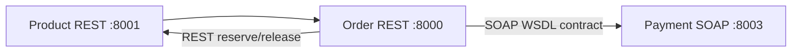

# Architecture

Successful order: `Client -> Order: POST /orders -> Product: GET/reserve -> Payment: ProcessPayment -> Order: CONFIRMED`.

Declined payment: `Order -> Product: reserve -> Payment: DECLINED -> Order: release compensation -> Client: 402`.

Cancellation: `Client -> Order: cancel -> Payment: RefundPayment -> Product: release -> Client: CANCELLED`.

## API summary

| Service | Operations |
|---|---|
| Product | GET/POST/PUT/DELETE `/products`, GET `/products/{id}`, POST reserve/release, GET `/health` |
| Order | POST/GET `/orders`, GET `/orders/{id}`, POST `/orders/{id}/cancel`, GET `/health` |
| Payment | SOAP `ProcessPayment`, `GetPaymentStatus`, `RefundPayment`; GET `/health` |

## Test scenarios

| Scenario | Expected result | Side effect |
|---|---|---|
| list products | 200 | seeded catalogue |
| missing product | 404 | none |
| reserve available stock | 200 | stock decreases |
| reserve insufficient stock | 409 | stock unchanged |
| release stock | 200 | stock increases |
| approved SOAP payment | APPROVED | transaction persisted |
| declined SOAP payment | DECLINED | transaction persisted |
| invalid card | SOAP Client fault | none |
| unknown transaction | SOAP Client fault | none |
| refund approved | REFUNDED | transaction updated |
| refund declined | SOAP Client fault | unchanged |
| successful order | 201 | confirmed, stock reserved |
| declined order | 402 | PAYMENT_FAILED, stock restored |
| cancelled order | 200 | refunded, stock restored |

## SOA rationale

Each service owns its database and deployable process, exposes a standardized REST or WSDL contract, and is composed by the order service without sharing persistence. Product and payment contracts are discovered through Swagger and WSDL. SOAP is appropriate for the payment boundary because its explicit XML contract and faults are useful for a financial operation; REST is simpler for catalogue and order resources.
